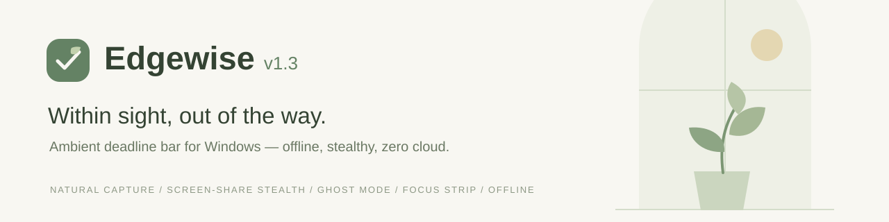

<p align="center"></p>
<p align="center">
  <a href="https://github.com/KennyMcSimpson/Edgewise/releases/latest"></a>
  <a href="LICENSE"></a>
  
  
  <a href="https://github.com/KennyMcSimpson/Edgewise/actions/workflows/desktop.yml"></a>
</p>
<p align="center"><strong>Ambient deadline bar for Windows.</strong><br />An offline, zero-account floating task rail that tucks into your screen edge, understands natural-language deadlines, stays invisible on screen shares, and turns urgency into calm color.</p>
<p align="center"><a href="https://github.com/KennyMcSimpson/Edgewise/releases/latest"><strong>Download for Windows</strong></a> &nbsp; · &nbsp; <a href="#quick-capture-syntax">Quick capture</a> &nbsp; · &nbsp; <a href="#getting-started">Getting started</a> &nbsp; · &nbsp; <a href="https://github.com/KennyMcSimpson/Edgewise/issues">Report an issue</a></p>

> Formerly known as **Qingdan**. Existing local tasks and settings in `%APPDATA%\Qingdan` are imported automatically into `%APPDATA%\Edgewise` on first launch without touching your previous folder.

---

## Why Edgewise?

Mainstream task managers bury deadlines inside heavy dashboards behind account walls. Sticky-note apps forget dates, clutter your screen, and leak private notes during screen shares. Edgewise stays on the periphery of your monitor and gets out of the way:

| Feature | What it does |
| --- | --- |
| **Offline natural-language quick capture** | Type `Submit paper fri 18:00 !`, `Check run in 30m`, `Send slides eod // attach table 2`, `Dec 5th`, `next week`, `Standup weekdays 09:00`, or `pin: Keep backups` right in the bar — live preview chips with a 1-click `Raw` literal escape hatch. |
| **Drag-and-drop URL → 1-click link loop** | Drop any browser URL onto the window or 46px edge tab to generate a clean title (`github.com · pull/123`) while preserving the full link in notes. Reopen `http(s)` links in 1 click directly from any task row or the editor link pill. |
| **Hide from screen share** | Native Windows capture exclusion (`WDA_EXCLUDEFROMCAPTURE`): your task list stays visible to your eyes while disappearing from Zoom, Teams, Discord, and OBS screen shares. |
| **Ghost click-through mode (`Ctrl+Alt+G`)** | Float translucently over your IDE or browser without blocking clicks. Displays a compact titlebar pill in Compact mode so nothing clips, and exits safely via `Ctrl+Alt+G`, `Ctrl+Alt+Q`, or the system tray. |
| **46px edge tab with peripheral countdown** | Switch away and Edgewise shrinks against the nearest screen edge with a live countdown (`OVER`, `20m`, `3h`, `2d`, `CALM`) and full 3-tier urgency colors (amber → orange → red). |
| **Adjustable single-task focus strip** | Enter Focus directly from any task row or the compact strip. Cycle `15 / 25 / 45 / 60m` presets while paused, extend `+5m` on the fly, track progress on a hairline 2px bar, and complete in 1 click. |
| **Hover-overlay actions, `+1w` snooze & routine `Skip`** | Task titles reclaim full narrow-column width until hovered; hover reveals `+1h` / `Tmr` / `+1w` snooze, routine `Skip` (without cluttering Completed), Focus, and external link buttons — all undoable. |
| **Quiet break with real alert suppression** | Pause the window and desktop notifications for `15 / 30 / 60` minutes from the footer, Settings, or system tray while recurring schedules continue rolling cleanly. |
| **Keyboard-first flow & cross-tab search** | Switch tabs with `Ctrl+1–5`, navigate rows with `↑/↓`, act with `Enter`/`Space`/`f`, save notes with `Ctrl+Enter`, dismiss back to the edge tab with `Ctrl+Alt+Q` / `Esc`, and jump directly to matching hits in other tabs while searching. |
| **100% local, zero runtime dependencies** | Atomic `fsync` writes, automatic `.bak` recovery, 20 daily snapshots, 30-step undo, JSON backup/restore, and Markdown (`.md`) checklist export. |

---

## Quick Capture Syntax

All parsing happens 100% locally with zero dependencies. Live chips appear above the input before you press Enter (click **Raw** anytime to save literal text):

| You type | What Edgewise creates |
| --- | --- |
| `Submit camera-ready PDF fri 18:00 !` | Deadline this Friday at `18:00`, marked **Important** |
| `Check GPU eval in 30m` / `Follow up in 3 days` | Relative deadline (`+30m`, `+3h`, `in 30m`, `in 2 hrs`, `in 3 days`, `in 1 wk`) |
| `Send slides by eod` / `Call advisor tomorrow noon` | Office time anchors (`eod` 18:00, `noon` 12:00, `this morning` 09:00, `fri afternoon` 14:00, `today evening` 19:00) |
| `Conference rebuttal Dec 5th` / `Ship report next week` | Calendar dates (`YYYY-MM-DD`, `MM/DD`, `Dec 5th`, `May 1st`, `next week`) |
| `Review PR +4h // verify edge tab clipping` | Deadline + inline note separated by whitespace-bounded ` // ` (URLs like `https://` stay intact) |
| `Standup weekdays 09:00` (or `Standup 09:00` on Repeat tab) | Recurring routine (`daily`, `every day`, `weekdays`, `every mon`; time-only entries on the Repeat tab default to Daily) |
| `pin: Never push to upstream main` | Pinned reminder on the top shelf (`pin:` or `sticky:`) |

---

## Getting Started

1. Open **[Releases](https://github.com/KennyMcSimpson/Edgewise/releases/latest)** and download `Edgewise-1.4.0-windows-x64.zip`.
2. Extract the **entire** archive to a permanent folder.
3. Double-click **`Edgewise.exe`**, type a task in the bottom bar, and press Enter.

The runtime is bundled — no Node.js or Python installation is required on your machine. Target platform: **Windows 10 / 11 x64**. Builds are unsigned; every release includes `SHA256SUMS.txt`.

### Keyboard Shortcuts

| Shortcut | Action |
| --- | --- |
| `Ctrl + Alt + Q` | Show / dismiss Edgewise globally (tucks to edge tab when Auto-tuck is enabled) |
| `Ctrl + Alt + G` | Toggle Ghost click-through overlay globally |
| `Ctrl + 1` – `Ctrl + 5` | Switch between All, DDL, Repeat, Pinned, and Done tabs |
| `↑` / `↓`, `Enter`, `Space`, `f` | Navigate visible rows, edit, toggle complete, or enter Focus Strip |
| `Ctrl + N` | Open the detailed task editor (`Ctrl + Enter` saves from anywhere in the dialog) |
| `Ctrl + F` | Search titles and notes (shows clickable match counts in other tabs) |
| `Ctrl + Z` | Undo last action (inside text fields, undoes typing) |
| `Esc` | Close search / toast / selection, exit Ghost when focused, or dismiss to edge tab |

---

## Your Data, On Your Computer

- Stored in `%APPDATA%\Edgewise\edgewise.json` (open directly from Settings).
- Automatically imports existing `%APPDATA%\Qingdan` data on first launch without deleting or altering the legacy folder.
- Atomic temp-file + `fsync` writes, `.bak` auto-recovery, and up to 20 rolling daily snapshots.
- Export/restore portable JSON backups (compatible with legacy Qingdan backups) or export a clean grouped Markdown checklist (`.md`).
- Network requests are blocked at the Electron session layer (`connect-src 'none'` + `onBeforeRequest` cancel); external links only open on explicit click and strictly validate `http:` / `https:`.

---

## Development & Verification

Requires Node.js 24+:

```sh
npm ci
npm test         # Zero-dependency core logic & persistence suite
npm start        # Launch desktop app
npm run test:ui  # Real Electron UI & IPC integration tests
```

MIT License — see [LICENSE](LICENSE).
